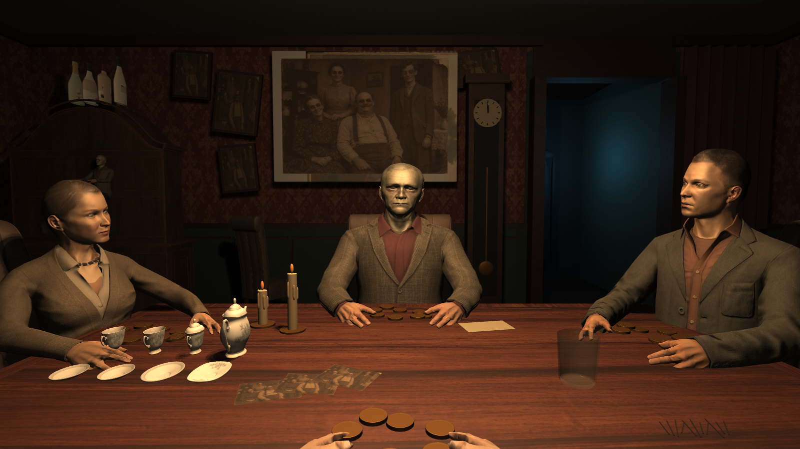
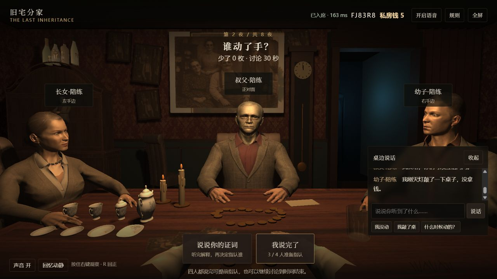
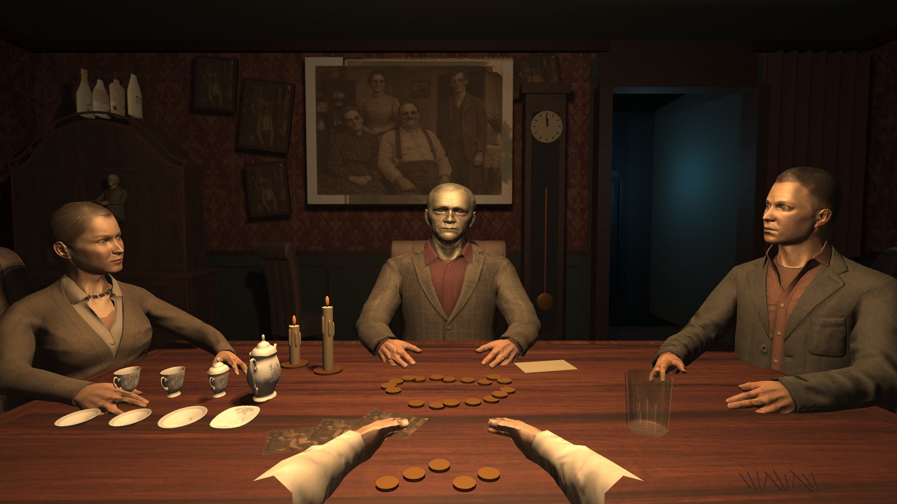
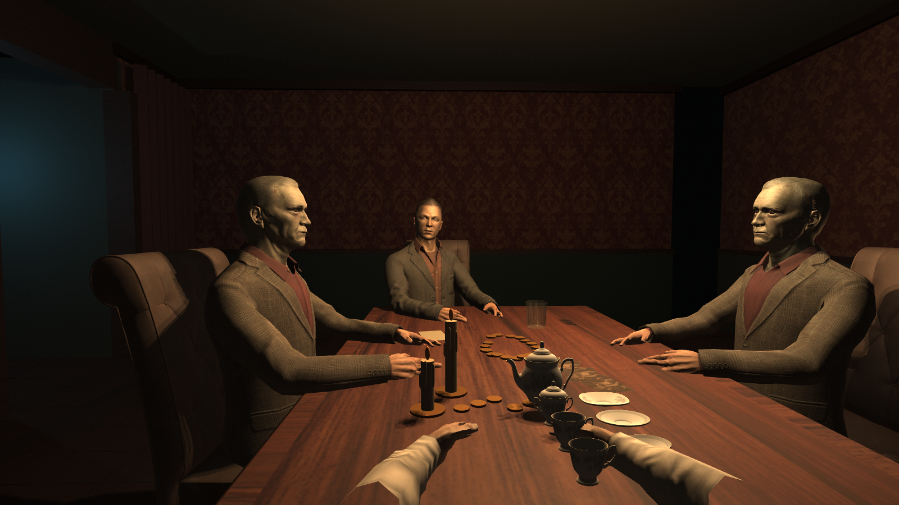
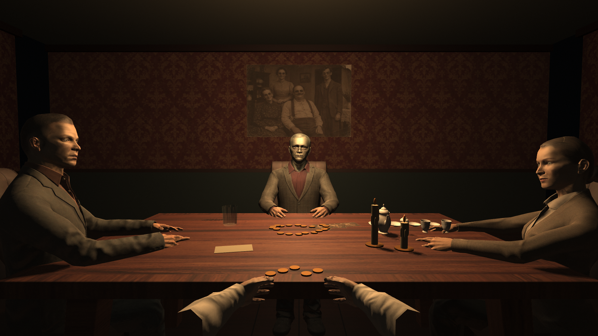
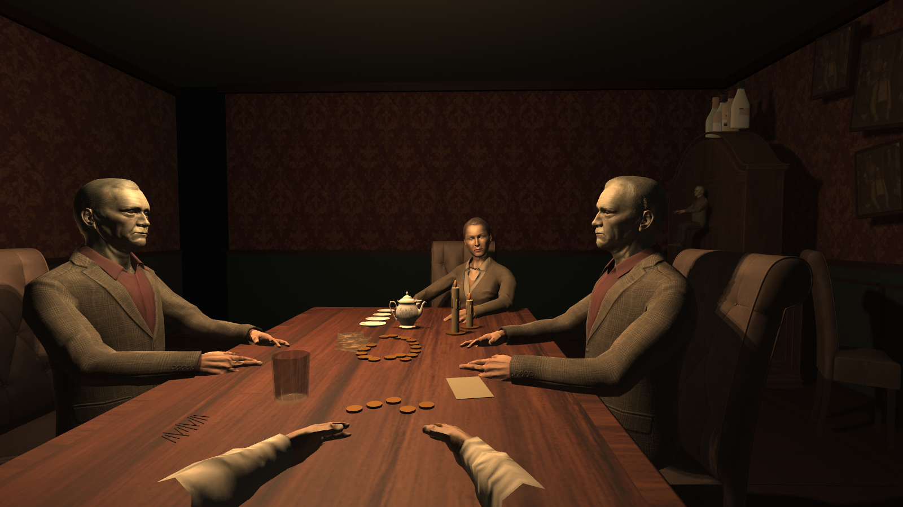
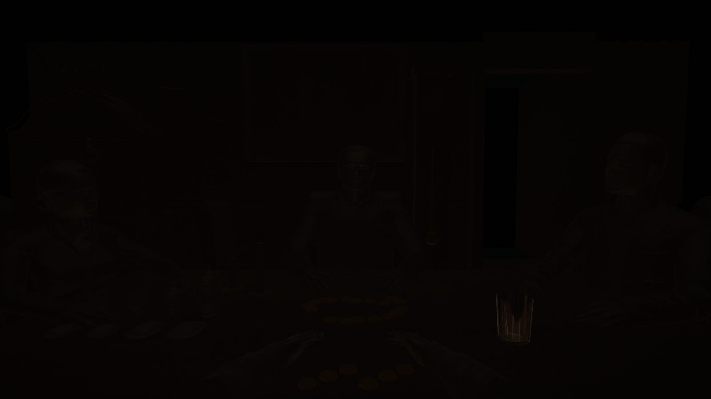
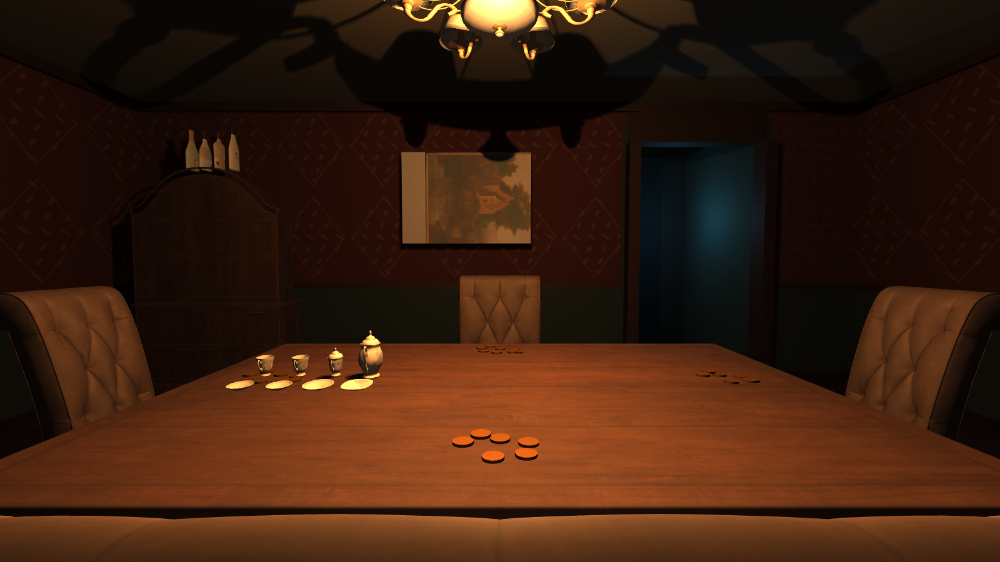
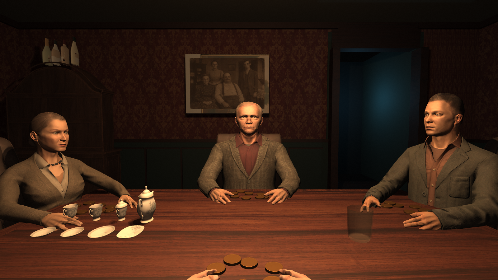

<div align="center">

# 旧宅分家 · The Last Inheritance

**灯灭三秒。钱少了一枚。桌边的每个人，都有自己的说法。**

四人围桌 · 心理博弈 · 3D 恐怖 · Unity WebGL

[**在线试玩 →**](https://last-inheritance-night-table.featherysardine32.chatgpt.site) · [玩法与操作](#玩法与操作) · [本地运行](#本地运行) · [测试记录](#测试记录)



</div>

《旧宅分家》是一个可以实际联机的四人心理博弈原型。四名继承人围坐在旧宅餐桌旁，趁熄灯行动，再用证词掩盖自己的选择。声音给你方向与大致时机，但偷钱和敲桌听起来相同：你可以抓住一个破绽，却仍要为指认承担风险。

> **当前阶段：可玩原型。** 仓库包含 Unity 工程、浏览器界面、权威房间服务器、自动测试与约 27 MB 的预构建三维浏览器资源。页面中的图片均为实际场景或浏览器截图，非目标概念图。

## 实机画面

### 浏览器对局与中文界面



### 四个座位的实际视角

| 座位一 | 座位二 |
| --- | --- |
|  |  |
|  |  |

<details>
<summary>查看黑灯阶段与场景迭代</summary>

黑灯时无法辨认其他人的行动，听觉承担主要线索作用。



| 初始饭厅 | 加入围桌人物 |
| --- | --- |
|  |  |

</details>

## 玩法与操作

1. 每人初始 **5 枚私房钱**，一局 **8 夜**。创建房间，将六位房间码发给朋友；也可加入陪练或直接选择单人陪练。
2. **灯灭 3 秒**：偷一枚钱、敲一下桌子，或者不动。每夜最多行动一次。
3. 亮灯只公布总共少了几枚钱。结合声音的方向与大致时段，讨论各人的证词。四人都点「我说完了」可提前进入指认。
4. 同时指认一人或保持沉默：猜中奖励 **1 枚**，猜错扣 **1 枚**，最低扣至零。
5. 被抓住的偷钱者退赔最多 **2 枚**，多人指认同一人不会重复罚款。八夜结束后余额最高者获胜，可并列，并能复盘真实行动。

| 操作 | 功能 |
| --- | --- |
| `Q` / 点击「偷一枚」 | 黑灯时偷钱 |
| `E` / 点击「敲一下」 | 黑灯时制造相同动静 |
| 右键按住移动鼠标 | 在座位上观察 |
| `R` | 视角回正 |
| 选择人物 → 确认指认 | 提交指认；也可保持沉默 |
| 「开启语音」 | 自愿启用麦克风；也支持文字聊天 |

## 已有功能

- 四人房间、房间码组队、准备开局、陪练、腾出座位与房主迁移。
- 服务器控制行动窗口、私密余额、指认、结算、排名和重开。
- 定向动作音、回忆动静面板、程序化手部反馈和同步灯光。
- 中文 UI、文字聊天、快捷证词与可选 WebRTC 语音。
- 同一标签页刷新重连，掉线时对局可按阶段超时继续。
- 暖光餐桌、冷光走廊、家族肖像、柜中人偶、旧钟与蜡烛构成的旧宅场景。

## 本地运行

### 浏览器完整玩法

需要 **Node.js 24**。仓库自带 Unity 浏览器资源，不必先安装 Unity，也没有额外 npm 依赖。

```bash
cd WebPreview
npm run build
npm run preview
```

打开 **http://127.0.0.1:8791**。同一台电脑可在四个标签页加入同一个房间验证联机，也可直接选单人陪练。默认服务仅监听本机；异地好友请使用上方在线试玩地址。

需要更换端口时，在 PowerShell 中先执行 `$env:PORT=8798`。本地数据库和测试输出写入 `WebPreview/outputs`，不会提交到仓库。

### Unity 场景与导出

使用 **Unity 6000.3.23f1** 打开仓库根目录，场景位于 `Assets/Scenes/InheritanceDiningRoom.unity`。首次打开会重新导入素材。

- 编辑器直接 Play 用于三维场景检查；完整房间和 UI 在浏览器中运行。
- 安装 WebGL Build Support 后，菜单 **Last Inheritance → Export browser art preview** 可重新导出浏览器资源。
- 导出完成后，在 `WebPreview` 执行 `npm run build` 更新界面和服务器包。
- **Last Inheritance → Verify four runtime seats** 可输出实际 Play 模式的四座位截图。

WebGL 导出贴图上限为 1024，源图片保持原始尺寸。当前三维资源约 27 MB，较此前约 61 MB 的导出减少约 56%。

### 服务端部署

正式房间使用 **Cloudflare Worker + D1**，静态文件位于 `WebPreview/dist/client`。构建会生成 `WebPreview/dist/server/wrangler.json`，部署者需要创建自己的 D1 数据库、填写该配置的数据库 ID，并应用 `WebPreview/drizzle/0000_rooms.sql`。原发布账号的部署身份和凭据不包含在本仓库中。

GitHub 仓库用于源码和截图展示；仅使用 GitHub Pages 无法运行这里的动态房间 API。

## 项目结构

```text
Assets/                    Unity 场景、美术、交互与编辑器工具
Packages/                  Unity 包依赖
ProjectSettings/           Unity 工程配置
WebPreview/
  client/                  中文 UI、声音、输入与房间客户端
  server/                  权威规则状态机与 Worker API
  drizzle/                 D1 数据库迁移
  scripts/                 构建、本地服务与长测工具
  tests/                   规则、并发、重连和信令测试
  dist/client/Build/       预构建的 Unity WebGL 资源
docs/screenshots/          实际截图
docs/verification.json     汇总测试证据
ArtResearch/资源清单.md      资源来源及美术迭代记录
```

## 测试记录

2026-11-24 的验证记录（并非四名真人的体验或平衡性测试）：

| 检查 | 结果 |
| --- | --- |
| 自动测试 | 20 项通过，含 10,000 个随机回合的总钱数与非负余额检查 |
| 本机四独立客户端连续 2 小时 | 134 轮、49,455 次请求、79 次重连，通过 |
| 浏览器完整流程 | 八夜、指认奖惩、最终排名和复盘已实际操作 |
| 公网首次 15 分钟 | 通过 |
| 公网延长测试 | 约 47 分钟后一次 fetch 失败，原因未确定，保留失败记录 |
| 公网恢复回归 24 分钟 | 7,784 次请求，通过，无重试 |
| 四浏览器语音 | 同机合成音互通、关闭与重连通过；未替代真人跨网络验证 |

汇总数据见 [verification.json](docs/verification.json)。重新运行自动测试：

```bash
cd WebPreview
npm test
```

GitHub Actions 会在推送及 PR 时执行测试和浏览器打包检查。两小时长测可运行 `node scripts/soak.mjs`，先启动本地服务；使用 `GAME_URL` 环境变量指定目标地址。

## 当前限制

- 人物使用固定坐姿网格、轻微头部动作与程序化手部反馈，尚无完整表情、口型或精细手指动画；第四个角色复用已有模型。
- 语音使用公共 STUN，未配置 TURN。受限网络可能无法直连，文字聊天仍可使用。
- 低内存设备及同时打开多个三维页面的性能仍需继续适配，建议电脑浏览器与耳机。
- 两小时测试主要验证规则和状态一致性，不能证明真人对局的趣味性、平衡性或所有公网环境的稳定性。

## 美术来源与许可

家具与基础材质主要来自 [Poly Haven](https://polyhaven.com/)，按其 CC0 许可使用；人物来自 [Microsoft Rocketbox](https://github.com/microsoft/Microsoft-Rocketbox)，保留 MIT 声明。虚构家庭肖像和部分材质经过生成式制作或修改。

详见 [资源清单](ArtResearch/资源清单.md)、[人物来源](Assets/Art/Cast/SOURCES.md) 与 [第三方许可声明](THIRD_PARTY_NOTICES.md)。公开可见不等于项目原创内容自动授予开源许可；原创代码及美术的再分发授权尚未另行指定，第三方内容继续适用各自许可。
